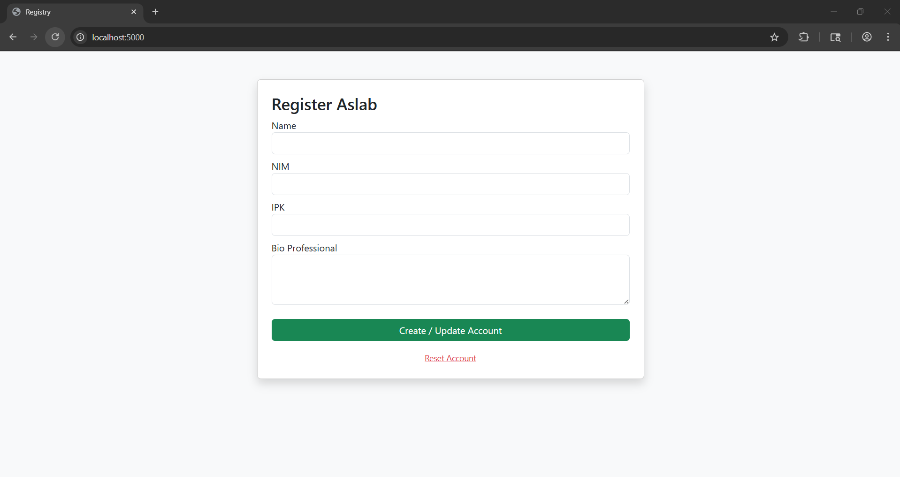
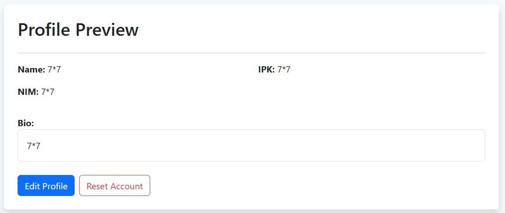
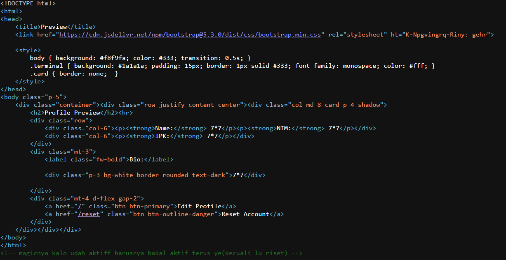
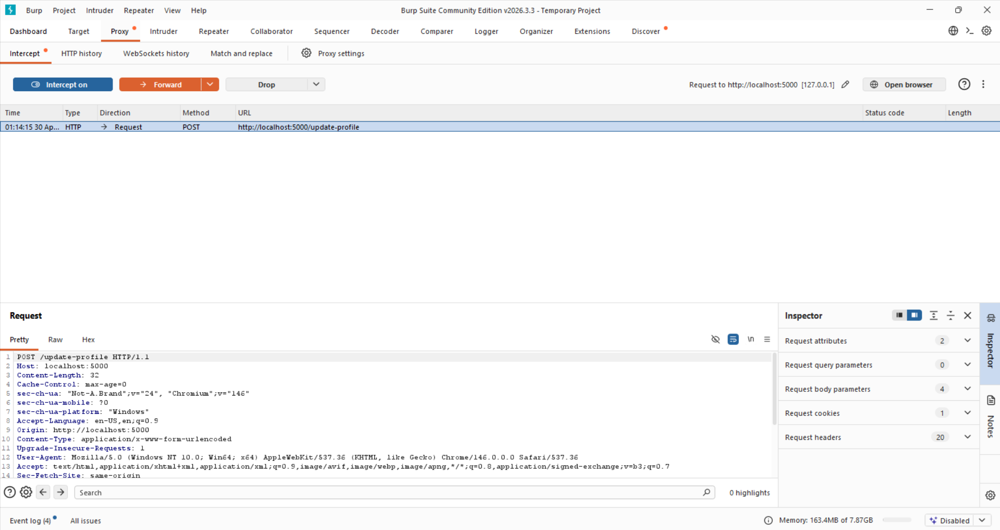
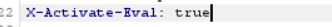
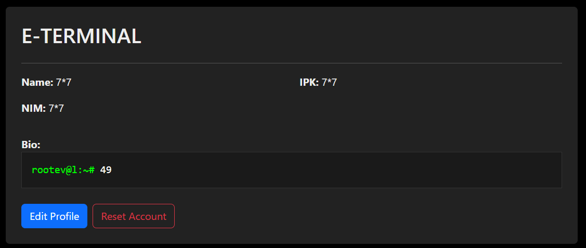
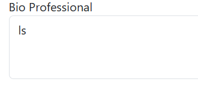
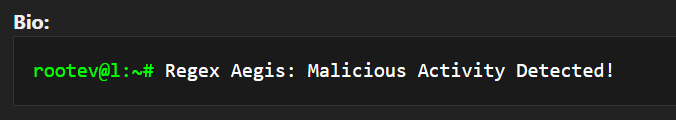
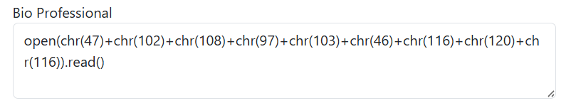
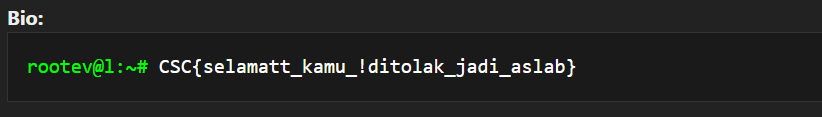

# The Registry

| | |
|---|---|
| **Category** | Web Exploitation |
| **Topic** | Eval Bypass + Character Manipulation (Python `eval()`/Blacklist Bypass) |
| **Difficulty** | Medium |
| **Author** | Dhio (diX) |
| **Event** | CSC CTF Contest 2026 |

> ⚠️ This challenge intentionally wraps Python `eval()` around user input behind a (deliberately imperfect) filter, purely for CTF purposes. Never do this in production code.

## Description

Challenge ini mensimulasikan celah keamanan pada fungsi `eval()` di Python. User diminta untuk membaca file `flag.txt` di root directory, namun aplikasi memiliki filter keamanan yang cukup ketat.

**Filter yang diterapkan:**
- **Keyword blacklist:** `os`, `eval`, `exec`, `socket`, `ls`, `cat`, `shell`, dll.
- **Karakter & pola:** slash (`/`), backslash (`\`), titik dua kali (`..`), serta pola ekstensi file (seperti `.txt`).
- **Encoding:** format hexadecimal (`0x`) dan unicode (`\u`) juga diblokir.

## Design notes

Filter di atas memblokir hampir semua jalur RCE/path-reading yang umum dipakai, termasuk encoding trick yang biasa jadi jalan pintas (hex, unicode). Fitur eval sendiri juga tidak aktif secara default — baru bisa dipicu lewat header tersembunyi yang di-encode dengan ROT13 di komentar HTML. Celah yang disisakan dengan sengaja adalah fungsi `chr()`, yang tidak masuk daftar blacklist, sehingga peserta harus menyadari bahwa string terlarang bisa direkonstruksi dari kode ASCII tanpa pernah mengetik karakter aslinya.

## Writeup

### Step 1 — Recon & hidden hint

Tampilan awal aplikasi adalah form pendaftaran "Aslab" (Name, NIM, IPK, Bio Professional).



Inspeksi Page Source (Ctrl+U) menemukan dua hint tersembunyi:

1. Block keyword "haram" biar gak bisa RCE: `os`, `eval`, `exec`, `socket`, dkk.
2. Filter regex buat nangkis hex, unicode, sama path traversal (biar gak ngintip file).

Dari situ bisa disimpulkan aplikasi punya celah RCE pada salah satu input, tapi ada filter yang memblokir fungsi eksekusi sistem dan pola karakter tertentu (hex/unicode/traversal).

### Step 2 — Validasi input & hidden header

Untuk memvalidasi input mana yang rentan, dicoba payload operasi matematika sederhana di keempat form yang tersedia. Tidak ada satupun yang langsung menghasilkan output, mengindikasikan filter yang ketat atau proses yang bersifat blind.



Pencarian lebih dalam di page source menemukan komentar tersembunyi ("magicnya kalo udah aktiff harusnya bakal aktif terus ye") dan atribut janggal `ht="K-Npgvingrq-Riny: gehr"`. Setelah di-decode dengan ROT13, string ini menjadi `X-Activated-Eval: true` — menandakan fitur eval di server bersifat kondisional dan baru aktif kalau header ini disisipkan ke request.



### Step 3 — Mengaktifkan eval lewat Burp Suite

Request diintercept pakai Burp Suite, lalu header `X-Activated-Eval: true` disisipkan sebelum request diteruskan ke server.





Setelah request dikirim, `eval()` terbukti aktif pada input di kolom Bio — ditandai perubahan tampilan UI menjadi dark mode sebagai indikator visual bahwa backend siap menerima payload.



### Step 4 — Membaca flag.txt lewat bypass `chr()`

Perintah umum seperti `ls`, `cat`, atau path langsung (`/flag.txt`) semuanya diblokir oleh keyword blacklist dan filter regex.





Celah yang tidak ikut diblokir adalah fungsi `chr()`. Dengan memanfaatkan kode ASCII, string terlarang bisa direkonstruksi tanpa pernah mengetiknya langsung:

**Konversi manual** (`/flag.txt`):
`/` (47), `f` (102), `l` (108), `a` (97), `g` (103), `.` (46), `t` (116), `x` (120), `t` (116)

**Payload akhir:**
```python
open(chr(47)+chr(102)+chr(108)+chr(97)+chr(103)+chr(46)+chr(116)+chr(120)+chr(116)).read()
```



### Flag



```
CSC{selamat_kamu_!ditolak_jadi_aslab}
```

Dengan ini, seluruh rangkaian proteksi mulai dari hidden header hingga regex filter berhasil dilewati, dan tantangan dinyatakan selesai.

## Takeaways

- Blacklist berbasis keyword/regex gampang punya celah kalau fungsi "aman" seperti `chr()` tidak ikut dipikirkan — payload bisa direkonstruksi karakter demi karakter tanpa pernah menulis string terlarang.
- Hint tersembunyi (ROT13 di atribut HTML) menunjukkan pentingnya selalu cek page source, bukan cuma UI yang terlihat.
- Intercepting proxy (Burp Suite) diperlukan untuk memodifikasi header request secara manual — sesuatu yang tidak bisa dilakukan lewat UI biasa.
